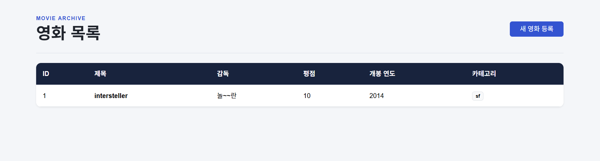
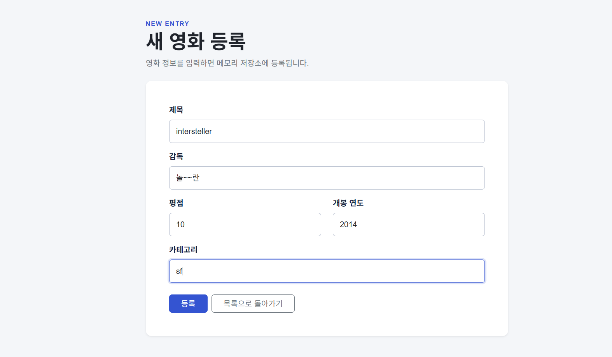

# Spring Boot 영화 관리 Web UI

Spring Boot와 Thymeleaf를 이용하여 구현한 메모리 기반 영화 관리 프로그램입니다.

기존 REST CRUD 프로젝트의 Controller, Service, Repository 구조를 유지하면서 영화 목록 조회 화면과 영화 등록 Form을 추가했습니다. Controller가 조회한 데이터를 Model에 저장하고, Thymeleaf가 이를 이용하여 HTML 화면을 생성하도록 구현했습니다.

## 1. 프로젝트 소개

### 1.1 프로젝트 주제

영화 정보를 등록하고 목록으로 조회할 수 있는 Web UI 프로그램입니다.

영화는 다음 데이터로 구성됩니다.

| 필드 | 자료형 | 설명 |
|---|---|---|
| `id` | `Long` | 영화 식별 번호 |
| `title` | `String` | 영화 제목 |
| `director` | `String` | 영화 감독 |
| `rating` | `int` | 영화 평점 |
| `pubyear` | `int` | 영화 개봉 연도 |
| `category` | `String` | 영화 카테고리 |

`id`는 영화가 메모리 저장소에 저장될 때 자동으로 생성됩니다.

### 1.2 GitHub Repository

```text
[GitHub Repository URL 입력]
```

### 1.3 Render 배포 URL

```text
[Render 배포 후 URL 입력]
```

### 1.4 개발 환경

- Java 17
- Spring Boot 4.1.1
- Gradle
- Spring Web MVC
- Thymeleaf
- HTML
- CSS
- Bootstrap 5.3.8

### 1.5 프로젝트 구조

```text
week6_sb_crud_web
├── README.md
├── build.gradle
├── settings.gradle
├── gradlew
├── gradlew.bat
├── images
│   ├── movie-list.png
│   └── movie-form.png
│
└── src
    ├── main
    │   ├── java
    │   │   └── org.example.webui.week6_sb_crud_web
    │   │       ├── controller
    │   │       │   ├── MovieController.java
    │   │       │   └── MovieWebController.java
    │   │       ├── domain
    │   │       │   └── Movie.java
    │   │       ├── dto
    │   │       │   ├── MovieRequest.java
    │   │       │   └── MovieResponse.java
    │   │       ├── repository
    │   │       │   ├── MovieRepository.java
    │   │       │   └── MemoryMovieRepository.java
    │   │       ├── service
    │   │       │   └── MovieService.java
    │   │       └── Week6SbCrudWebApplication.java
    │   │
    │   └── resources
    │       ├── templates
    │       │   └── movies
    │       │       ├── list.html
    │       │       └── form.html
    │       ├── static
    │       │   └── css
    │       │       └── style.css
    │       └── application.properties
    │
    └── test
```

### 1.6 Layered Architecture

프로젝트는 다음과 같은 계층 구조로 구성했습니다.

```text
MovieWebController
        ↓
MovieService
        ↓
MovieRepository
        ↓
MemoryMovieRepository
        ↓
Map<Long, Movie>
```

각 계층의 역할은 다음과 같습니다.

- `MovieWebController`: 브라우저의 HTTP 요청을 처리하고 View를 반환합니다.
- `MovieService`: 영화 등록과 조회에 필요한 비즈니스 로직을 처리합니다.
- `MovieRepository`: 영화 데이터의 저장과 조회 기능을 정의합니다.
- `MemoryMovieRepository`: Java Collection을 이용하여 영화 데이터를 저장합니다.
- Thymeleaf: Model에 저장된 데이터를 이용하여 HTML 화면을 생성합니다.

### 1.7 실행 방법

프로젝트 최상위 폴더에서 다음 명령을 실행합니다.

#### Windows PowerShell

```powershell
.\gradlew.bat bootRun
```

애플리케이션이 정상적으로 실행되면 기본 포트인 `8080`을 사용합니다.

영화 목록 화면:

```text
http://localhost:8080/movies
```

영화 등록 화면:

```text
http://localhost:8080/movies/new
```

기존 REST API:

```text
http://localhost:8080/api/movies
```

`application.properties`에 `server.port` 설정이 없기 때문에 Spring Boot의 기본 포트인 `8080`으로 실행됩니다.

### 1.8 주요 화면

#### 영화 목록 화면

등록된 영화 정보를 HTML 테이블로 출력합니다.



#### 영화 등록 화면

제목, 감독, 평점, 개봉 연도, 카테고리를 입력하여 새로운 영화를 등록합니다.



### 1.9 Web Endpoint

| HTTP Method | URL | 기능 |
|---|---|---|
| `GET` | `/movies` | 전체 영화 목록 화면 |
| `GET` | `/movies/new` | 영화 등록 Form 화면 |
| `POST` | `/movies` | Form 데이터로 새로운 영화 등록 |

기존 REST API는 `/api/movies` 경로를 사용하고, 새로운 Web UI는 `/movies` 경로를 사용합니다.

| 구분 | 기본 URL | 반환 형식 |
|---|---|---|
| REST API | `/api/movies` | JSON |
| Web UI | `/movies` | HTML |

### 1.10 주요 기능

#### 영화 목록 조회

Controller가 Service를 통해 전체 영화 목록을 조회한 뒤 Model에 저장합니다.

```java
@GetMapping
public String list(Model model) {
    model.addAttribute("movies", movieService.findAll());
    return "movies/list";
}
```

Thymeleaf는 Model에 저장된 `movies`를 반복하여 HTML 테이블에 출력합니다.

```html
<tr th:each="movie : ${movies}">
    <td th:text="${movie.id}"></td>
    <td th:text="${movie.title}"></td>
    <td th:text="${movie.director}"></td>
    <td th:text="${movie.rating}"></td>
    <td th:text="${movie.pubyear}"></td>
    <td th:text="${movie.category}"></td>
</tr>
```

#### 영화 등록 화면

다음 URL에서 새로운 영화 정보를 입력할 수 있습니다.

```text
GET /movies/new
```

HTML Form은 다음 주소로 데이터를 전송합니다.

```html
<form th:action="@{/movies}" method="post">
```

각 입력 요소의 `name`은 `MovieRequest`의 필드명과 일치합니다.

```text
name="title"     → title
name="director"  → director
name="rating"    → rating
name="pubyear"   → pubyear
name="category"  → category
```

#### 영화 등록 처리

Controller는 `@ModelAttribute`를 이용하여 Form 데이터를 `MovieRequest`로 전달받습니다.

```java
@PostMapping
public String create(@ModelAttribute MovieRequest request) {
    movieService.create(request);
    return "redirect:/movies";
}
```

영화가 등록되면 `/movies`로 Redirect하여 목록을 다시 조회합니다.

### 1.11 CSS 및 Bootstrap 적용

Bootstrap 5.3.8을 jsDelivr CDN 방식으로 `list.html`과 `form.html`에 적용했습니다. Bootstrap CSS를 먼저 불러오고 프로젝트의 `style.css`를 나중에 불러와 세부 디자인을 덮어쓸 수 있도록 구성했습니다.

목록 화면에는 다음 Bootstrap 기능을 사용했습니다.

- `container`, `d-flex`: 제목과 버튼 배치
- `table-responsive`: 작은 화면에서 테이블 가로 스크롤
- `table`, `table-hover`, `table-dark`: 영화 목록 Table
- `btn`, `btn-primary`: 신규 등록 버튼
- `badge`: 영화 카테고리 표시

등록 화면에는 다음 Bootstrap 기능을 사용했습니다.

- `container`, `row`, `col-*`: 반응형 Form 배치
- `card`, `shadow-sm`: 등록 Form 영역
- `form-label`, `form-control`: 입력 항목
- `btn-primary`, `btn-outline-secondary`: 등록 및 목록 이동 버튼

`src/main/resources/static/css/style.css`에는 Bootstrap 스타일을 보완하는 색상, 여백, 입력 포커스 및 모바일 화면 스타일을 작성했습니다. AI로 생성하거나 개선한 UI 구간은 HTML과 CSS 주석으로 표시했습니다.

## 2. 이번 과제 키워드

### `@Controller`

HTTP 요청을 처리하고 View 이름을 반환하는 Spring MVC Annotation입니다.

`@RestController`가 객체를 JSON 등의 응답 본문으로 반환하는 것과 달리, `@Controller`는 Thymeleaf HTML 화면을 반환할 때 사용합니다.

### Thymeleaf

서버에서 전달받은 데이터를 HTML에 출력하는 서버 사이드 템플릿 엔진입니다.

이번 프로젝트에서는 다음 문법을 사용했습니다.

- `th:each`: Collection 데이터 반복
- `th:text`: 데이터를 HTML 텍스트로 출력
- `th:href`: 링크 URL 생성
- `th:action`: Form 전송 URL 생성

### Model

Controller에서 View로 데이터를 전달하기 위한 객체입니다.

```java
model.addAttribute("movies", movieService.findAll());
```

위 코드에서 `"movies"`는 View에서 데이터를 찾을 때 사용하는 이름이고, `movieService.findAll()`은 실제 전달되는 값입니다.

### `@ModelAttribute`

HTML Form에서 전달된 요청 파라미터를 Java 객체의 필드와 연결합니다.

```java
public String create(@ModelAttribute MovieRequest request)
```

HTML `input`의 `name`과 `MovieRequest`의 필드명이 일치해야 합니다.

### HTML Form

사용자가 입력한 데이터를 서버로 전송하는 HTML 요소입니다.

```html
<form th:action="@{/movies}" method="post">
```

이번 프로젝트에서는 영화 제목, 감독, 평점, 개봉 연도, 카테고리를 입력받습니다.

### `redirect:`

Controller가 특정 URL로 브라우저를 다시 이동시키도록 지시할 때 사용합니다.

```java
return "redirect:/movies";
```

### PRG Pattern

PRG는 Post-Redirect-Get의 약자입니다.

```text
POST /movies
→ 영화 데이터 저장
→ redirect:/movies
→ GET /movies
→ 영화 목록 출력
```

POST 처리 후 Redirect와 GET 요청을 수행하여 브라우저 새로고침으로 같은 데이터가 다시 등록되는 문제를 방지합니다.

### Bootstrap

Bootstrap은 Form, 버튼, 테이블, 반응형 레이아웃 등의 스타일을 제공하는 CSS 프레임워크입니다.

이번 프로젝트에서는 Bootstrap 5.3.8을 CDN 방식으로 적용했습니다. `container`와 Grid 클래스가 화면 크기에 맞는 레이아웃을 만들고, Table, Form, Button 클래스를 통해 일관된 UI를 구성합니다. 프로젝트의 `style.css`를 함께 사용하여 영화 관리 화면에 맞는 색상과 여백을 추가했습니다.

### Layered Architecture

Controller, Service, Repository의 책임을 분리하는 구조입니다.

```text
Controller
→ Service
→ Repository
→ Memory
```

각 계층의 책임을 분리하여 코드의 역할을 명확하게 하고 유지보수하기 쉽게 만듭니다.

## 3. 핵심 내용 정리

1. `@Controller`는 View 이름을 반환하고, `@RestController`는 데이터를 HTTP 응답 본문으로 반환한다.
2. Controller는 `Model`에 데이터를 저장하여 Thymeleaf View로 전달한다.
3. Thymeleaf의 `th:each`와 `th:text`를 사용하여 Collection 데이터를 HTML에 반복 출력할 수 있다.
4. HTML Form의 `name`과 DTO 필드명이 일치하면 `@ModelAttribute`가 입력 데이터를 객체에 연결한다.
5. PRG 패턴은 POST 처리 후 Redirect와 GET 요청을 수행하여 새로고침으로 인한 중복 등록을 방지한다.

## 4. Weekly Report

### 4.1 Key Learning

이번 주에 배운 핵심 내용은 다음과 같습니다.

1. `@Controller`와 `@RestController`의 응답 방식 차이
2. Model을 이용하여 Controller의 데이터를 View로 전달하는 방법
3. HTML Form의 입력값이 `@ModelAttribute`를 통해 DTO에 연결되는 과정

### 4.2 Web UI Flow

```text
Browser
→ Controller
→ Service
→ Repository
→ Memory
→ Model
→ Thymeleaf
→ HTML
```

브라우저가 `GET /movies`를 요청하면 `MovieWebController`가 요청을 받습니다.

Controller는 `MovieService`를 통해 전체 영화 데이터를 조회합니다. Service는 `MovieRepository`를 사용하여 메모리에 저장된 데이터를 가져옵니다.

Controller는 조회 결과를 Model에 `"movies"`라는 이름으로 저장합니다. Thymeleaf는 Model 데이터를 이용하여 `list.html`을 처리하고, 완성된 HTML을 브라우저에 전달합니다.

### 4.3 Form Flow

```text
HTML Form
→ POST /movies
→ MovieWebController
→ MovieService
→ MovieRepository
→ Memory
→ redirect:/movies
→ GET /movies
→ 영화 목록 출력
```

사용자가 등록 화면에서 값을 입력하고 등록 버튼을 누르면 `POST /movies` 요청이 발생합니다.

Spring MVC는 HTML `input`의 `name`을 기준으로 입력값을 `MovieRequest`에 연결합니다. Controller는 Service에 등록을 요청하고, Service는 Repository를 통해 데이터를 메모리에 저장합니다.

등록이 끝나면 `redirect:/movies`를 반환합니다. 브라우저는 `GET /movies`를 새로 요청하고, 등록된 영화가 포함된 목록 화면을 출력합니다.

### 4.4 Problem & Solution

애플리케이션을 실행하는 과정에서 다음 오류가 발생했습니다.

```text
Web server failed to start. Port 8080 was already in use.
```

오류 메시지를 통해 8080 포트를 이미 다른 프로세스가 사용하고 있다는 사실을 확인했습니다.

IntelliJ에서 Spring Boot 애플리케이션이 이미 실행 중이었기 때문에 터미널에서 같은 포트로 서버를 다시 실행할 수 없었던 것이 원인이었습니다.

기존에 실행 중인 애플리케이션을 확인하여 별도의 서버를 중복 실행하지 않고 문제를 해결했습니다.

이 과정을 통해 실행 실패가 코드 오류 때문인지 실행 환경의 포트 충돌 때문인지 로그를 통해 구분하는 방법을 배웠습니다.

### 4.5 Code Review

가장 중요하다고 생각한 코드는 영화 등록을 처리하는 `create()` 메서드입니다.

```java
@PostMapping
public String create(@ModelAttribute MovieRequest request) {
    movieService.create(request);
    return "redirect:/movies";
}
```

이 코드는 다음 세 가지 역할을 담당합니다.

1. `@ModelAttribute`를 통해 Form 데이터를 `MovieRequest`로 전달받습니다.
2. `MovieService`에 영화 등록을 요청합니다.
3. 등록 완료 후 `/movies`로 Redirect하여 PRG 패턴을 완성합니다.

Form 데이터 전달과 메모리 저장, 목록 화면 이동을 연결하는 메서드이기 때문에 가장 중요한 코드라고 생각했습니다.

### 4.6 AI Usage

AI를 활용하여 다음 내용을 학습하고 확인했습니다.

- `@Controller`와 `@RestController`의 차이
- Spring MVC에서 Model이 수행하는 역할
- Thymeleaf의 `th:each`, `th:text`, `th:href`, `th:action`
- HTML Form과 `@ModelAttribute`의 연결 과정
- Redirect와 PRG 패턴의 동작 방식
- CSS를 이용한 테이블과 페이지 스타일 작성 방법
- Bootstrap 5를 이용한 반응형 목록 및 등록 Form UI 생성
- README 구조와 과제 요구사항 점검

AI가 제공한 내용을 그대로 적용하지 않고 다음 내용을 직접 확인하고 수정했습니다.

- `MovieWebController`의 URL과 HTTP Method
- 목록 화면의 Model 변수명이 `movies`인지 확인
- `th:each`, `th:text`, `th:href`, `th:action` 문법 확인
- Form의 `th:action="@{/movies}"`와 `method="post"` 확인
- HTML Form의 `name`과 `MovieRequest` 필드명의 일치 여부
- `rating`과 `pubyear` 입력 필드의 숫자 타입
- `category` 입력 필드의 문자열 타입
- CSS 파일 경로와 Thymeleaf 연결
- Bootstrap CDN과 사용한 Bootstrap 클래스 확인
- 영화 등록과 목록 출력 동작
- 등록 후 Redirect 동작
- 새로고침 시 중복 등록 여부

AI가 Bootstrap 기반 `list.html`, `form.html`, `style.css`를 생성하고 개선했으며, 해당 구간을 소스코드 주석으로 표시했습니다. 생성된 UI에서도 기존 URL, HTTP Method, Form action, input name, Model 변수명과 Thymeleaf 표현식을 유지하도록 검토했습니다.

### 4.7 Reflection

이번 과제를 통해 Controller가 HTML을 직접 만드는 것이 아니라 데이터를 Model에 저장하고, Thymeleaf가 Model의 데이터를 이용하여 HTML을 생성한다는 점을 이해했습니다.

또한 HTML Form의 `name`이 단순한 화면 속성이 아니라 서버의 DTO 필드와 데이터를 연결하는 중요한 역할을 한다는 것을 알게 되었습니다.

앞으로는 Form 입력값이 잘못되었을 때 사용자에게 오류 메시지를 표시하는 방법과 입력값 검증 방법을 더 학습하고 싶습니다.

### 4.8 건의사항

없음

## 5. 데이터 저장 방식

이 프로젝트는 데이터베이스를 사용하지 않습니다.

영화 데이터는 `MemoryMovieRepository`의 Java Collection에 저장됩니다.

```java
private final Map<Long, Movie> store = new LinkedHashMap<>();
```

애플리케이션을 종료하면 메모리에 저장된 영화 데이터가 사라집니다. 애플리케이션을 다시 실행하면 빈 저장소에서 시작합니다.

## 6. 구현 확인

다음 기능의 동작을 확인했습니다.

- Spring Boot 애플리케이션 실행
- 영화 목록 페이지 출력
- 영화 등록 Form 출력
- Form 데이터와 `MovieRequest` 연결
- 영화 데이터 메모리 저장
- 등록 후 영화 목록으로 Redirect
- 등록한 영화의 목록 출력
- 새로고침 시 중복 등록 방지
- Thymeleaf를 이용한 데이터 반복 출력
- CSS를 이용한 화면 스타일 적용
- Bootstrap 5를 이용한 반응형 목록 및 등록 Form 구성
- 기존 REST API 유지
